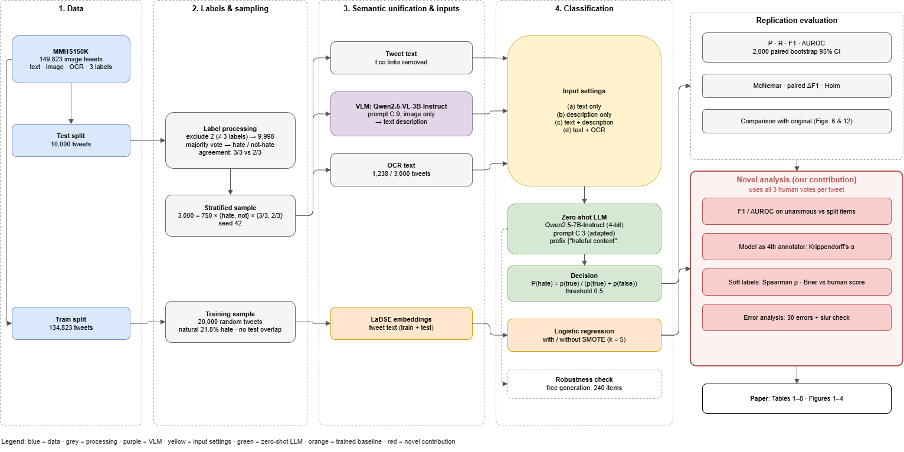
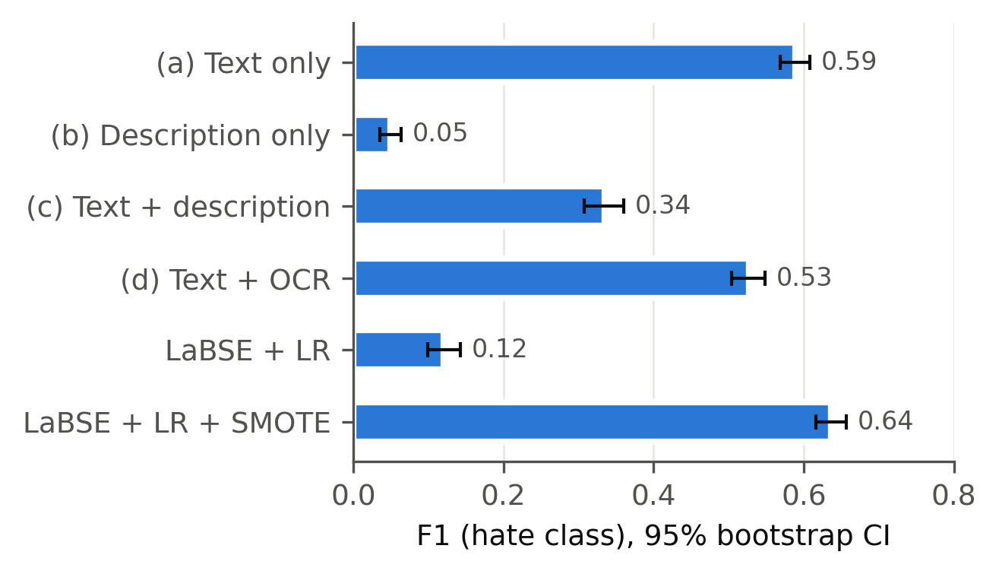

# Do Models Fail Where Humans Disagree?

**A methodological replication of VLM-based hate-speech annotation (Nemani & Garimella, ICWSM 2026) on MMHS150K, with a test of the label-disagreement hypothesis.**

**Authors:** Aditi Srivastava, Apurva Joshi, Rohit Kaliyar — Dept. of CSE, Bennett University, Greater Noida

[](https://colab.research.google.com/github/Apurva-joshi19/vlm-hate-replication/blob/main/notebooks/full_pipeline.ipynb)




Nemani & Garimella (2026) convert images into text descriptions with vision–language models ("semantic unification") and conclude that LLMs cannot yet replace human annotators for hate speech, attributing part of the gap to disagreement among annotators. Their WhatsApp data are private. This repository replicates their hate-annotation pipeline on the public MMHS150K dataset with open models on a free Colab T4 GPU, and then tests their untested explanation directly.

## Key results (3,000 stratified test tweets)



| System | Precision | Recall | F1 [95% CI] | AUROC |
|---|---|---|---|---|
| (a) Text only — zero-shot Qwen2.5-7B | 0.572 | 0.606 | 0.589 [0.569, 0.608] | 0.621 |
| (b) Image description only | 0.557 | 0.026 | 0.050 [0.035, 0.064] | 0.540 |
| (c) Text + description (original set-up) | 0.708 | 0.219 | 0.335 [0.308, 0.360] | 0.619 |
| (d) Text + OCR | 0.581 | 0.481 | 0.527 [0.504, 0.548] | 0.602 |
| LaBSE + logistic regression | 0.772 | 0.065 | 0.120 [0.099, 0.143] | 0.690 |
| LaBSE + LR + SMOTE | 0.644 | 0.630 | 0.637 [0.616, 0.657] | 0.681 |

- **Replicated:** SMOTE raises trained-classifier hate F1 from 0.12 to 0.64 (original: 0.29 to 0.60), and zero-shot LLMs are not a reliable substitute for annotators.
- **Not replicated:** adding VLM image descriptions *lowers* zero-shot F1 (0.589 → 0.335) without changing accuracy or AUROC — the model becomes more conservative. On MMHS150K the hate lives mostly in the tweet text.
- **Novel finding:** every system, trained or zero-shot, ranks items near chance (AUROC 0.53–0.59) where annotators split 2–1. Replacing one annotator with the LLM lowers Krippendorff's α from 0.333 to 0.196, and 85% of LLM probabilities are below 0.05 or above 0.95, so they cannot serve as soft labels.

## Repository structure

```
notebooks/full_pipeline.ipynb   all steps, in run order (Parts 0-9)
prompts/                        exact prompts (adapted from the original Appendix C.9 and C.3)
figures/                        paper figures + architecture diagram (draw.io)
data/sample_3000_ids.txt        tweet IDs of the stratified sample
results/                        result tables (CSV) used in the paper
```

## How to run

1. Open `notebooks/full_pipeline.ipynb` in Google Colab and select **Runtime → Change runtime type → T4 GPU**.
2. Create a Kaggle API token (kaggle.com → Settings → API) and upload `kaggle.json` when Part 0 asks for it.
3. Run Parts 0–3 (data, sampling, VLM descriptions; ~2 h on a T4).
4. **Restart the runtime**, re-run the Part 0 setup cell, then run Parts 4–5 (zero-shot classification and decoding checks; ~1 h). The VLM and the 7B LLM do not fit in GPU memory together.
5. Parts 6–9 run on CPU.

Every long step writes to Google Drive after each batch and skips finished items when re-run, so a Colab disconnect never loses work. All random operations use seed 42. GPU inference can differ in the last decimal place between hardware and library versions.

### Models

| Role | Model |
|---|---|
| Image descriptions | `Qwen/Qwen2.5-VL-3B-Instruct` (fp16, greedy, ≤200 tokens) |
| Zero-shot classifier | `Qwen/Qwen2.5-7B-Instruct` (4-bit NF4) |
| Baseline embeddings | `sentence-transformers/LaBSE` |

The classifier's answer is prefixed with `{"hateful content":` and P(hate) = p(true) / (p(true) + p(false)) is read from a single forward pass (threshold 0.5), which reproduces the original study's JSON-constrained output deterministically.

## Data

MMHS150K (Gomez et al., WACV 2020) is downloaded from Kaggle (`victorcallejasf/multimodal-hate-speech`). It is distributed for research under its authors' copyright, so this repository contains **only tweet IDs, code, prompts and aggregate results** — no tweet text or images.

## Ethics

The dataset contains offensive and hateful language. Slurs appear in the code only as search patterns for the aggregate analysis. Our results show that the zero-shot model over-flags in-group uses of the n-word while missing most slur-free hate; such a model should not be used for content moderation without human review.

## Citation

If you use this code, please cite the original study:

> Nemani, H., and Garimella, K. 2026. Large-Scale Multimodal Content Analysis and Annotation with Vision-Language Models. In *Proceedings of the International AAAI Conference on Web and Social Media (ICWSM 2026)*.

> Gomez, R., Gibert, J., Gomez, L., and Karatzas, D. 2020. Exploring Hate Speech Detection in Multimodal Publications. In *Proceedings of WACV 2020*.

## AI assistance

An AI assistant (Claude, Anthropic) helped design and debug the code. All experiments were run and all results verified by the authors.
